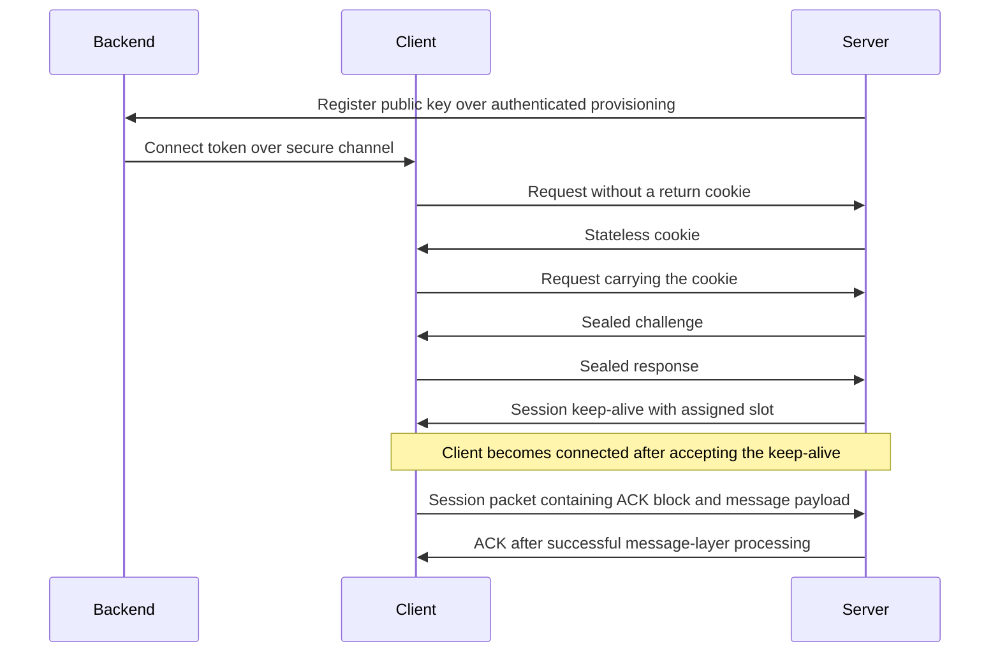

# RocketNet standard

The RocketNet standard is three documents:

- [standard/TRANSPORT.md](../standard/TRANSPORT.md) — RN-1, the normative
  transport standard: packets, the handshake, keys, replay, acknowledgements,
  fragmentation, timing and counters.
- [standard/MESSAGES.md](../standard/MESSAGES.md) — RN-2, the normative message
  standard: message forms, delivery, channels, receipts, blocks, resend and
  send budgets.
- [standard/RATIONALE.md](../standard/RATIONALE.md) — RN-R, the informative
  rationale: why the standard is shaped as it is, and the design notes.

[standard/STYLE.md](../standard/STYLE.md) defines their conventions and section ids.

## Start with the question you need to answer

This guide is informative. RN-1 and RN-2 define the requirements; RN-R
explains them. If a guide, a test or the current SDK disagrees with a
requirement, record the disagreement instead of silently choosing one as the
contract. The public C API is defined separately in
[sdk/rocketnet.h](../sdk/rocketnet.h).

| Your task | Reading order |
| --- | --- |
| Understand the system | RN-1 [scope](../standard/TRANSPORT.md#t1), [parties and keys](../standard/TRANSPORT.md#t2), then the exchange below |
| Implement a backend | RN-1 [key inventory](../standard/TRANSPORT.md#t2.2), [token](../standard/TRANSPORT.md#t6), [security](../standard/TRANSPORT.md#t19) |
| Implement a client or server | RN-1 [encoding](../standard/TRANSPORT.md#t4) through [receive processing](../standard/TRANSPORT.md#t10), the appropriate [client](../standard/TRANSPORT.md#t11) or [server](../standard/TRANSPORT.md#t12) state machine, then [session](../standard/TRANSPORT.md#t13) through [conformance](../standard/TRANSPORT.md#t20) |
| Implement message delivery | RN-2 [connection-layer prerequisites](../standard/MESSAGES.md#m1.4), [forms](../standard/MESSAGES.md#m2), [records](../standard/MESSAGES.md#m3), [checks](../standard/MESSAGES.md#m4), then the numbered delivery and scheduling sections |
| Investigate a refusal | RN-1 [ordered receive checks](../standard/TRANSPORT.md#t10) and [counters](../standard/TRANSPORT.md#t18); RN-2 [receiver checks](../standard/MESSAGES.md#m4) |
| Understand a design choice | The same section ID in [RN-R](../standard/RATIONALE.md) |

## One connection, end to end

The normal path below omits retries and refusals. The state tables define
those paths, their guards and their deadlines.



A valid signature authorizes the token. The cookie checks return reachability
before expensive handshake work. The challenge and response establish the
connection keys and slot. An application send begins work; it does not imply
that the receiver has received or delivered anything.

## Distinctions that matter

| Terms | Keep them separate |
| --- | --- |
| Packet sequence / message number | RN-1 sequences identify sealed packets. RN-2 numbers identify reliable records. A resend keeps the record's number and uses a fresh packet sequence. |
| Replay acceptance / acknowledgement | Opening a packet can mark security replay state before message processing succeeds. An ACK waits for the required acceptance conditions; storage exhaustion can withhold it. |
| Wire capacity / send policy | SINGLE can encode 1415 data bytes. The sender's plain-unreliable promotion threshold is 1411 bytes; a larger application message is promoted even though SINGLE has more encoding capacity. |
| Fragment index / fragment count | RN-2 indexes start at zero. The wire field `fragments` stores count minus one. For three fragments, the encoded value is 2 and valid indexes are 0, 1 and 2. |
| Fragment ring offset / block base | A fragment's `ring` field already identifies that fragment's position, in 16-byte units. It is not the block base. |
| Resend delay / reliable timeout | The former schedules another attempt; the latter ends an unacknowledged connection. Convert `_ms` configuration values to seconds before using them with time inputs. |
| Transport fragments / message blocks | RN-1 reassembles a payload. RN-2 reassembles a reliable message from records. They have separate identifiers, limits and acceptance rules. |

For example, a three-fragment block placed at byte zero has ring fields
0, 72 and 144 with the current 1152-byte stride. Fragment 1 is copied to
byte 1152, not byte 2304. The existing
[block vectors](../standard/MESSAGES.md#m8) include a complete example.

With a first RTT sample of 0.100 seconds, both the smoothed RTT and deviation
become 0.100. The uncapped resend delay is
`2 * 0.100 + 4 * 0.100 + 0.030 = 0.630` seconds. A configured 500 ms maximum
caps it at 0.500 seconds. This does not change the separate reliable timeout.

## Reading and checking with an AI

Retrieve the complete section and its linked prerequisites, including field
tables and state tables. Cite the document, section ID and rule number when
recording a decision. Treat rationale as explanation, and a vector as one
case with explicit inputs. Do not infer a general permission from a boundary
vector or turn an implementation detail into a new requirement.

For any proposed implementation, identify the actor, preconditions, byte
layout, units, state changes, refusal counter and observable outcome. Check
the boundary cases on both sides of each limit. If two passages disagree,
report both and add a regression case when the contract is resolved.

## What the checks establish

From the repository root:

```sh
python3 tools/conformance/test_check_rn_standard.py
python3 tools/conformance/check_rn_standard.py
python3 tools/conformance/check_rn_standard.py --print-index
python3 tools/conformance/test_check_witnesses.py
python3 tools/conformance/check_witnesses.py
```

| Evidence | What it establishes | Limit |
| --- | --- | --- |
| `standard/pins/*.tsv` | Documented values agree with expressions compiled against the SDK | Does not validate prose or runtime transitions |
| Vector checker | Published bytes match the corresponding test fixtures | Does not execute the C++ tests |
| Executed vector tests | The implementation produces the expected result for those inputs | Does not prove all schedules or malformed inputs |
| `docs/WITNESSES.tsv` | Recorded requirements have resolvable code, test or model references | A partial inventory; `none` rows are gaps, and this checker does not run witnesses |
| Independent interoperability | Separately built endpoints agree on exercised exchanges | Requires a separate implementation and an explicit test matrix |

Use [Testing](TESTING.md) for build and execution gates. A green checker is
evidence for its stated checks, not a declaration that the entire standard is
correct or that every requirement has been tested.
